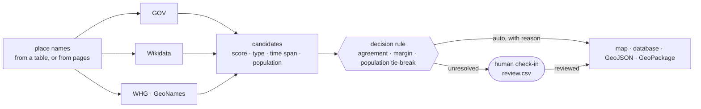
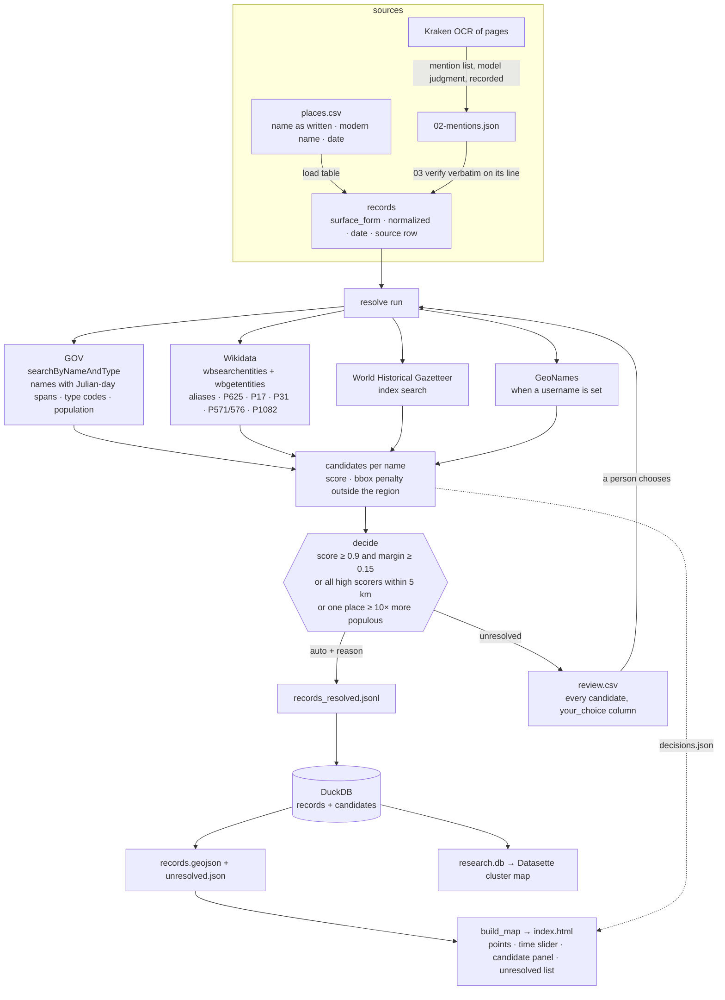
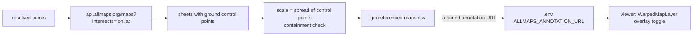
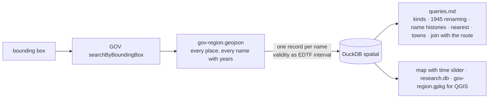

# Maps

Four worked examples. Two start from a table of names, one from the
transcription half, and one from map data alone with no text behind it.

## The idea

A place name is not a point. Between a name on a page (or in a
spreadsheet) and a dot on a map sit the gazetteers, which answer with
several candidates each, and a decision that has to be written down. The
map shows the dot, the candidates and the reason; what the rule could not
settle waits for a person.

That is the second diamond. The first (`../transcription/`) ends in a
corrected text; its place mentions enter here at the top.

## What runs where

| Use case | Starts from | Ends in | Open |
|---|---|---|---|
| [`01-places-to-map/`](01-places-to-map/) | 24 names from a synthetic 1786 ledger, in period spelling | 21 auto-resolved with reasons, 3 in review; a map with a candidate inspector; a Datasette site | [map](01-places-to-map/outputs/index.html) |
| [`02-historical-map-overlay/`](02-historical-map-overlay/) | the resolved points | what the Allmaps index offers at each point, each sheet's scale and a control-point check; why the overlay ships off and how to turn it on | [table](02-historical-map-overlay/outputs/georeferenced-maps.csv) |
| [`03-from-page-to-map/`](03-from-page-to-map/) | Kraken's OCR of five journal pages, errors included | 88 mentions checked verbatim, 36 of 56 names resolved, every point linked to a page and line | [map](03-from-page-to-map/outputs/index.html) |
| [`04-from-map-data/`](04-from-map-data/) | a GOV bounding-box extract: 1,715 places, 3,721 dated names, no text | questions in SQL (552 German names end and 955 Polish names begin in 1945), a map with a time slider across 1945, SQLite, GeoPackage for QGIS | [map](04-from-map-data/outputs/index.html) · [queries](04-from-map-data/outputs/queries.md) |

## The chains in detail

### Names to map (01), and pages to map (03)

### Historical map overlay (02)

### Map data in (04)

## How resolution works, in one paragraph

A name is sent to each gazetteer. Each returns candidates with a score
(exact name match 1.0; alias match; a penalty for non-settlements and for
places outside the project's region), coordinates, type, time span and
population when known. `reconcile.decide()` accepts automatically only when a
candidate is far ahead, or when all high-scoring candidates agree on one
location, or when one same-name place is at least ten times more populous
than the next (and says so). A name whose descriptor defeats the search
("Katzbach (river)") is retried bare, and the reason says so. Everything
else is `unresolved` and sits in `review.csv` with every candidate; a person
writes the chosen URI in `your_choice` and reruns, and the record becomes
`reviewed`. Every HTTP response is cached under `cache/`, so a rerun is free
and the evidence for every decision is on disk.
