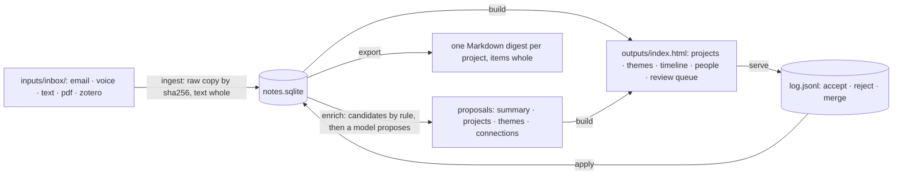

# Notes

One case: the **[notes apparatus](01-notes-apparatus/)**
([brief](01-notes-apparatus/HANDOFF.md)), scoped and not yet built. Ben's
notes arrive from everywhere: email to himself, voice memos, Markdown and
Word files, highlights in PDFs, items and notes in a reference manager. The
apparatus puts them in one local database, gathers them by project, tags
them with themes and connections once reviewed, posts a note under every
project it belongs to, and shows everything in a single page that opens
from disk.

It copies the reading room's log-and-serve pattern: a self-contained page,
a one-command local server on `127.0.0.1` that appends review actions to
an append-only log, and a browser fallback that exports the log to an
inbox. Everything stays on Ben's machine; the one step that sends text out
is `enrich`, which can be turned off, and an item marked private never
goes to it.

## Ben's material

His mail, voice notes, files and the derived store are not committed:
this repository is public, and the root `.gitignore` excludes
`inputs/inbox/` (except its README), `outputs/store/`, `outputs/exports/`
and every `.sqlite`. What is committed is code, `inputs/config/`, the
synthetic fixtures and the page.

## What Ben has to supply

How his email can be exported (Mail.app, Gmail Takeout `.mbox`, or
forwarding to one address); a few voice notes; his project list and first
themes; then whether he uses Zotero and which sources must never go to a
model.
