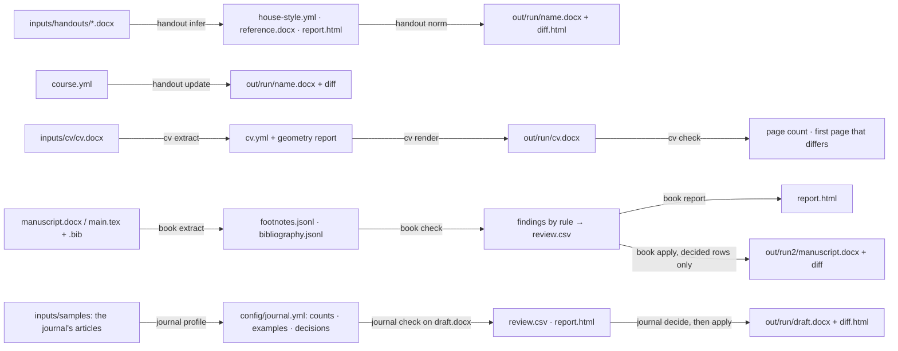

# Style

Four chores Ben wants done the same way every time, each its own case:

| Use case | What it does | Status | Brief |
|---|---|---|---|
| [`01-handouts/`](01-handouts/) | Infers a house style from his existing class handouts, applies it, and updates a handout for a new term: readings, year, course name, meeting times | scoped, not built | [`01-handouts/HANDOFF.md`](01-handouts/HANDOFF.md) |
| [`02-cv/`](02-cv/) | Adds entries to the CV by cloning a neighbouring entry's paragraph or table row, so page size, margins, indents and tab stops stay exactly his | built 19 November 2026, run on a synthetic CV | [`02-cv/README.md`](02-cv/README.md) |
| [`03-footnotes/`](03-footnotes/) | Checks a book-length manuscript's footnotes against its bibliography: short forms with no entry, entries never cited, broken ibid. chains, page ranges and punctuation | scoped, not built | [`03-footnotes/HANDOFF.md`](03-footnotes/HANDOFF.md) |
| [`04-journal-style/`](04-journal-style/) | Counts a journal's conventions in a few of its articles, lists where a draft differs with a proposed change for each, and writes the accepted changes to a copy | built 19 November 2026, run on synthetic files | [`04-journal-style/README.md`](04-journal-style/README.md) |

Formats: Word (`.docx`) first, LaTeX second; he may have others. Citation
style: not yet known; Chicago notes-bibliography is assumed and kept as a
config value.

What this is not: a document generator. Every command takes one of Ben's
documents, changes as little as possible, writes the result to a new place,
and reports what changed and what it refused to change.

## One package, four cases

The three cases share `src/mueser/style/` (see [`HANDOFF.md`](HANDOFF.md)
here for the shared parts): opening and saving `.docx`, extracting text,
cloning paragraph XML, converting to PDF through LibreOffice to count
pages, run folders, HTML diffs, and the cached OpenRouter client the
repository already has. Each case has its own commands:
`python -m mueser.style {cv,journal}` exist; `handout` and `book` are not
built.

## Ben's material

His handouts, CV and manuscript go in each case's `inputs/` and are not
committed: this repository is public, and the root `.gitignore` excludes
everything under those folders except the README, `config/` and the
synthetic `fixtures/`. Results go to `outputs/out/<run_id>/`, also
ignored. Nothing he gives it is ever overwritten.

## What Ben has to supply

For the two built cases: the current CV as `.docx`; and, for a
submission, the draft as `.docx` with three or more recent articles from
the journal. For the two scoped cases: three to five handouts, one
manuscript or chapter (LaTeX sources too if any), the citation style of
the book, and whether he wants the house style as a Word template he
applies himself.
