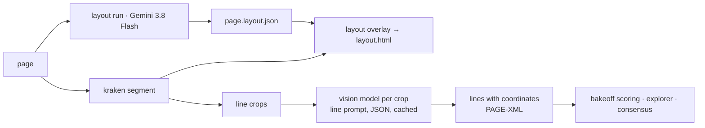

# Layout and hybrid: a vision model maps the page, then reads Kraken's lines

Open **`outputs/layout.html`** (the map of each page beside Kraken's lines)
and **`outputs/index.html`** / **`outputs/index-hand.html`** (the hybrid
readings scored against the whole-page readings and Kraken).

A whole-page reading by a vision model gives text without coordinates; an
OCR engine gives coordinates with weaker text. This use case takes the two
things a page needs before transcription (what is on it, and where) and
then combines the engines: Kraken draws the lines, a vision model reads
each one.

## The layout pass

`uv run python -m mueser.text.layout run --pages inputs/pages-print --out operations/work/layout --model google/gemini-3.8-flash`
(and the same for `pages-hand`) sent each page with the layout prompt
(`src/mueser/text/backends/prompts/layout_de.md`) and a JSON schema. The
model does not transcribe; it returns regions with a kind, hand, script,
a flag for a later hand, a note, and a box for every line, plus the
reading order and page notes. Run `20261105-090715`, six pages, $0.10.

| page | regions | lines | what it found |
|---|---|---|---|
| Gartenlaube 1853, p. 1 | 13 | 34 | the woodcut masthead as a figure; the oval ownership stamp "Richter" as a **later hand**; edition, issue number and year as heading and date line in Antiqua; the editorial body of 20 lines; two signature lines (Stolle, Keil); the subscription notice; "Die Verlagshandlung" as a sign-off |
| Grimm 1812, I p. 93 | 2 | 29 | page number and 28 lines of main text; show-through from the verso noted |
| Schiller 1796, p. 93 | 2 | 19 | page number and 18 lines; **script: Antiqua**, which corrected the Fraktur bake-off's README |
| Kaskel to Schnorr, 1864 | 7 | 23 | two facing pages; pencil pagination "84" as a later hand; salutation, two main-text regions in Kurrent with the names Meyerbeer and Raoul in Latin cursive, closing formula, date line, signature with paraph |
| Schnitzler to Beer-Hofmann, 1896 | 2 | 13 | 12 lines of letter body; one **correction**: an interlinear insertion above a struck word in line 5 |
| Poesiealbum 1901, p. 2 | 3 | 9 | a chromolithograph under the text; 7 lines of Kurrent verse; a signature and place in Latin cursive; a torn corner noted |

The line counts match the pages (the Grimm page has 28 printed lines; the
Kaskel letter 22 lines of text plus the pagination). What this gives the
transcription step: a list of what is *not* main text, so a stamp, a
pencil number or a marginal note can be transcribed as such or left out
on purpose, and a check on reading order for pages with columns.

The overlay (`outputs/layout.html`) draws the model's boxes on the left
and Kraken's line polygons on the right. The model's coordinates are
fractions of the image it saw, and on the Gartenlaube page its boxes sit
a little high; Kraken's are exact. Counts are the thing to compare: Kraken
finds 40 line polygons on the Gartenlaube page (it segments the masthead
lettering and ornaments too) where the model counts 34 lines of text.

## The hybrid reading

Run `print-20261105`, the three real print pages. Normalised CER:

| page | Kraken (segment + read) | Gemini 3.8 Flash, whole page | **hybrid**: Kraken lines + Gemini 3.8 Flash | **hybrid**: Kraken lines + Claude Haiku 5.5 |
|---|---|---|---|---|
| Schiller 1796 (Antiqua) | 0.015 | 0.021 | **0.010** | 0.011 |
| Grimm 1812 | 0.029 | **0.010** | 0.024 | 0.117 |
| Gartenlaube 1853 (masthead, two columns) | 0.034 | **0.014** | 0.038 | 0.065 |
| mean | 0.026 | 0.015 | 0.024 | 0.064 |
| $ per page | 0 | 0.014 | 0.110 | 0.005 |
| seconds per page | 14 | 31 | 297 | 68 |

What the hybrid buys and costs. It is the only reading that is both
model-quality and **positioned**: every line has Kraken's polygon, so the
PAGE-XML is complete and a line can be shown on the image. On the clean
Antiqua page it is the best reading of all. On the two Fraktur pages it
is a little worse than the whole-page reading, because Kraken's forty
polygons on the Gartenlaube page include the masthead lettering and
ornaments, which the model dutifully reads, and because a line read alone
has no context to repair a doubtful letter. Haiku per line is cheap and
weak; Gemini per line is strong and, at forty calls a page with reasoning
tokens on each, eight times the price of reading the page whole.

Run `hand-20261105`, the three real Kurrent pages, with Gemini 3.1 Pro
added as a whole-page reader. Normalised CER:

| page | Kraken | Gemini 3.8 Flash, whole page | Gemini 3.1 Pro, whole page | **hybrid**: Kraken lines + Gemini 3.8 Flash | **hybrid**: Kraken lines + Haiku 5.5 |
|---|---|---|---|---|---|
| Kaskel 1864 | 0.207 | **0.060** | **0.060** | 0.142 | 0.398 |
| Schnitzler 1896 | 0.429 | 0.278 | **0.176** | 0.482 | 0.569 |
| Poesiealbum 1901 | 0.819 | 0.710 | **0.708** | 0.797 | 0.840 |
| mean | 0.485 | 0.349 | 0.314 | 0.473 | 0.602 |
| $ per page | 0 | 0.018 | 0.007 | 0.167 | 0.004 |

On handwriting the hybrid loses to the whole-page reading on every page
and by a wide margin (0.14 against 0.06 on the clean 1864 hand). A line of
Kurrent cut from its page loses the context a reader uses to settle a
letterform; Kraken's segmenter also cuts the album page into 39 polygons
where the model, reading whole, counts 9 lines. The hybrid remains the way
to get coordinates onto a model reading, and the way to re-read only the
lines a person flagged; it is not the way to get the best first reading of
a hand. (Gemini 3.8 Flash also read the Schnitzler page this time, at
0.278, where the bake-off in use case 02 recorded an empty reply; both
runs are kept.)

`outputs/index.html` and `outputs/index-hand.html` show every reading of
each page with the diff; `outputs/consensus-print/` and
`outputs/consensus-hand/` are the consensus pages, with 8 to 36 spans per
page on the check-in list, and the album page flagged as too disputed for
span-level checking.

## The pipeline



```sh
L=01-use-cases/transcription/03-layout-and-hybrid
uv run python -m mueser.text.layout run --pages $L/inputs/pages-print --out $L/operations/work/layout --model google/gemini-3.8-flash
uv run python -m mueser.text.layout run --pages $L/inputs/pages-hand  --out $L/operations/work/layout --model google/gemini-3.8-flash
uv run python -m mueser.text.layout overlay --layouts $L/operations/work/layout --pages $L/inputs/pages-print --out $L/outputs/layout.html --kraken
uv run python -m mueser.text.bakeoff run --pages $L/inputs/pages-print --gt $L/inputs/gt --out $L/outputs --mode print --run-id print-20261105 \
  --backends kraken,openrouter:google/gemini-3.8-flash,hybrid:google/gemini-3.8-flash,hybrid:anthropic/claude-haiku-5.5
uv run python -m mueser.text.bakeoff run --pages $L/inputs/pages-hand  --gt $L/inputs/gt --out $L/outputs --mode hand  --run-id hand-20261105 \
  --backends kraken,openrouter:google/gemini-3.8-flash,openrouter:google/gemini-3.1-pro-preview,hybrid:google/gemini-3.8-flash,hybrid:anthropic/claude-haiku-5.5
uv run python -m mueser.text.report build --bakeoff $L/outputs/bakeoff_print-20261105.json --pages $L/inputs/pages-print --gt $L/inputs/gt --out $L/outputs/index.html
uv run python -m mueser.text.report build --bakeoff $L/outputs/bakeoff_hand-20261105.json  --pages $L/inputs/pages-hand  --gt $L/inputs/gt --out $L/outputs/index-hand.html
```

`hybrid:<model>` is one backend spec like any other, so it joins the
consensus step too. Each crop is cached by its hash; a rerun with the
same model and prompt sends nothing.

## What went wrong, and is recorded

The first hybrid run lost five of six page readings to single crops that
came back without JSON (a masthead ornament, a blank slice), because a
parse failure was retried like a network error and then aborted the page.
The fix, in `src/mueser/shared/openrouter.py` and `hybrid.py`: a tolerant
JSON extractor, one retry for a malformed reply, and a crop that still
yields nothing is written as `[...]` with the failure listed in the
reading's notes. The second run is the one scored above.

## Inputs and rights

The six real pages and their ground truth are copies from use cases 01
and 02 (Wikimedia Commons, public domain except the CC BY 4.0 album
photograph; transcriptions from Wikisource and the Commons descriptions,
with revision ids in those folders' `inputs/gt/provenance.json`).
