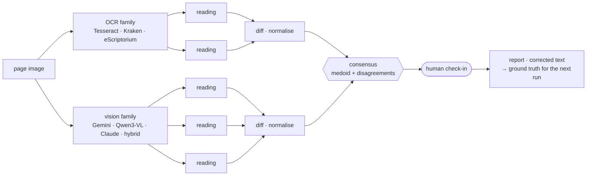
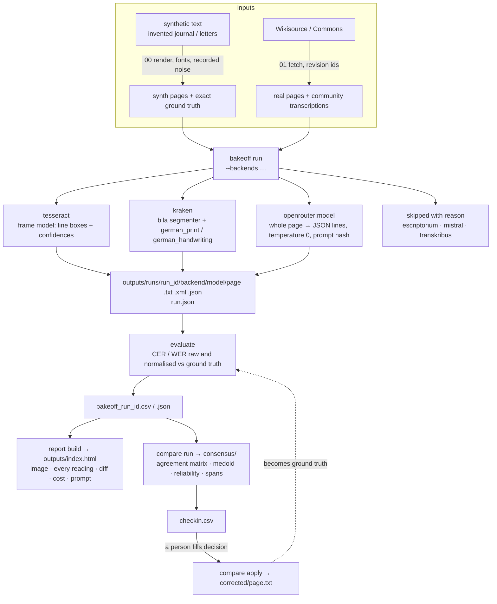
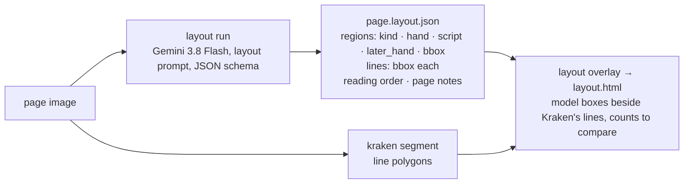
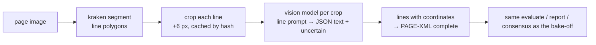

# Transcription

Three worked examples on the same pages: a Fraktur **print** bake-off, a
Kurrent **handwriting** bake-off, and a third that adds the two things a
whole-page reading cannot give you, a **layout map** of the page and a
**hybrid** reading that keeps every line's coordinates. All three end in
the same place: an explorer that shows the image beside every reading, a
consensus of the readers, and a check-in list for a person.

## The idea

One page goes to two families of readers. OCR engines segment the page
into lines and recognise shapes; vision-language models read the image
whole, with a sense of the language that can both repair and invent.
Each family's readings are diffed and normalised against each other (and
against ground truth where it exists), the disagreements are what a person
checks, and the report says what was read, by what, and how sure.

That is the first diamond: diverge into many readings, converge on one
text with its doubts marked, and let a person settle the doubts. The
corrected text feeds the next run as ground truth, and the maps half
(`../maps/`) is the second diamond.

## What runs where

| Use case | Pages | Readers that ran | Headline | Open |
|---|---|---|---|---|
| [`01-fraktur-print-bakeoff/`](01-fraktur-print-bakeoff/) | 5 synthetic + 3 real | 4 Tesseract models, Kraken, Gemini 3.8 Flash, Gemini 3.1 Pro, Qwen3-VL 235B, Claude Haiku 5.5 | Gemini 3.8 Flash: normalised CER 0.006 over 8 pages, 0.010–0.021 on the real ones; Kraken 0.018; best Tesseract 0.032. Whole run $0.23. | [explorer](01-fraktur-print-bakeoff/outputs/index.html) · [consensus](01-fraktur-print-bakeoff/outputs/consensus/index.html) |
| [`02-kurrent-handwriting/`](02-kurrent-handwriting/) | 3 synthetic + 3 real | Kraken, Tesseract (control), Gemini 3.8 Flash, Gemini 3.1 Pro, Qwen3-VL 235B, Claude Haiku and Sonnet 5.5 | see its README for the run's numbers | [explorer](02-kurrent-handwriting/outputs/index.html) · [consensus](02-kurrent-handwriting/outputs/consensus/index.html) |
| [`03-layout-and-hybrid/`](03-layout-and-hybrid/) | the 6 real pages | Gemini 3.8 Flash as a layout analyst; Kraken segmentation + Gemini / Haiku reading line crops | regions, lines, marginalia and later hands per page; a reading with coordinates | [layout overlay](03-layout-and-hybrid/outputs/layout.html) · [explorer](03-layout-and-hybrid/outputs/index.html) |

## The chains in detail

### Bake-off (01 and 02)

### Layout pass (03)

### Hybrid reading (03)

## What the numbers mean

A CER of 0.01 is one wrong character in a hundred, searchable text; 0.20 is
one in five, every line needs a hand. Both columns matter: **raw** says what
the reader wrote, **normalised** folds ſ→s, superscript umlauts, hyphenation
and whitespace so a modernising reader is neither punished nor rewarded in
silence. Synthetic pages are an upper bound; real pages are the measurement;
three of them are too few. Ben's own corrected pages, exported as PAGE-XML
into `inputs/gt/`, are what the table should finally be built on.

## Reading the consensus page

Agreement between two readings is 1 − their normalised distance. A reader's
**reliability** is its mean agreement with all the others on that page, so
on the Grimm page the four vision models score 0.946 and the Tesseract
models 0.86–0.92 without any ground truth being consulted. The **medoid** is
the reading closest to all the rest. A span is on the **check-in list**
when the readers that disagree with the medoid carry at least a quarter of
the page's reliability, so four weak OCR models dissenting together count
for less than one strong model. Where ground truth exists, the medoid's own
CER is shown beside the agreement figure; on the Fraktur run the medoid
was within 0.02 of the best reader on every page.
